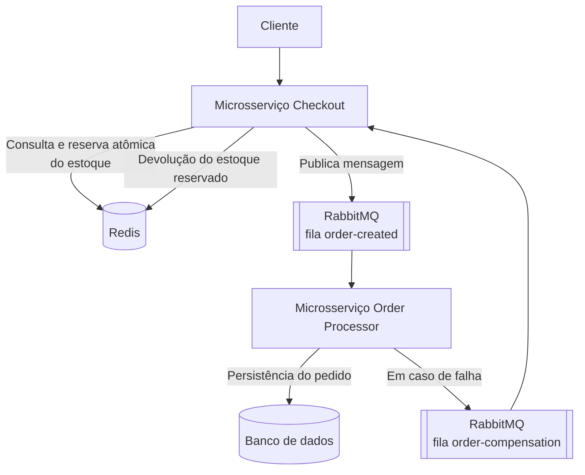

# Projeto Final: Sistema de Checkout e Reserva de Estoque Relâmpago (Flash Sale)

## 1. Contexto do Problema

Um marketplace está lançando uma campanha de **queima de estoque relâmpago** (_Flash Sale_). Durante esses eventos, muitos usuários tentam comprar o mesmo produto ao mesmo tempo.

O sistema precisa:

- Responder rapidamente ao cliente, sem aguardar a confirmação de toda a operação.
- Evitar _overselling_, isto é, vender uma quantidade maior que o estoque disponível.
- Processar pedidos de forma assíncrona e confiável.
- Devolver o estoque reservado caso ocorra uma falha durante o processamento.
- Permitir a consulta posterior do status de cada pedido.

## 2. Objetivo do Projeto

Desenvolver uma solução baseada em microsserviços para receber pedidos de uma promoção relâmpago, reservar estoque usando Redis, processar pedidos de forma assíncrona usando RabbitMQ e compensar reservas em caso de falha, aplicando uma SAGA simplificada.

## 3. Arquitetura Geral



## 4. Microsserviços

### 4.1 Microsserviço de Checkout

#### Responsabilidades

- Receber solicitações de compra.
- Validar os dados enviados pelo cliente.
- Consultar e reservar o estoque no Redis.
- Garantir que o estoque não fique negativo.
- Publicar pedidos para processamento em uma fila RabbitMQ.
- Permitir a consulta do status de pedidos.
- Consumir mensagens de compensação para devolver estoque em caso de cancelamento.

#### Endpoint: Criar Pedido

**Rota:**

```text
POST /v1/orders
```

**Request Body:**

```json
{
  "produto_id": "PROD-001",
  "quantidade": 2,
  "cliente_cpf": "50329291076",
  "cliente_nome": "Fernando Augusto"
}
```

#### Regras de negócio

1. O campo `produto_id` é obrigatório.
2. A `quantidade` deve ser maior que zero.
3. O CPF do cliente é obrigatório.
4. O sistema deve consultar o saldo disponível do produto no Redis.
5. Caso exista saldo suficiente:
   - Deve reservar/decrementar o estoque de modo atômico.
   - Deve gerar um identificador UUID v4 para o pedido.
   - Deve publicar uma mensagem na fila `order-created`.
   - Deve retornar `202 Accepted`.
6. Caso não exista saldo suficiente:
   - Deve retornar `409 Conflict`.

**Response — Sucesso (`202 Accepted`):**

```json
{
  "pedido_id": "b819cc65-f6f0-478c-8bb7-69ee1c4f6402",
  "status": "PROCESSING",
  "data_hora_requisicao": "2026-09-07T20:03:57"
}
```

**Response — Estoque insuficiente (`409 Conflict`):**

```json
{
  "mensagem": "Estoque insuficiente para o produto PROD-001"
}
```

### 4.2 Consulta de Pedido

**Rota:**

```text
GET /v1/orders/{pedido_id}
```

#### Regras de consulta

A consulta deve utilizar o padrão **Cache-Aside**:

1. Buscar o pedido no Redis.
2. Caso o pedido esteja no cache, retornar a resposta imediatamente.
3. Caso não esteja no cache, consultar o banco de dados.
4. Caso seja encontrado no banco:
   - Armazenar o resultado no Redis.
   - Definir um TTL sugerido de 5 minutos.
   - Retornar o pedido.
5. Caso não seja encontrado:
   - Realizar até 3 tentativas de busca.
   - Retornar `404 Not Found` ao final das tentativas.

**Response — Pedido encontrado (`200 OK`):**

```json
{
  "pedido_id": "b819cc65-f6f0-478c-8bb7-69ee1c4f6402",
  "produto_id": "PROD-001",
  "quantidade": 2,
  "cliente_cpf": "50329291076",
  "cliente_nome": "Fernando Augusto",
  "status": "CONFIRMED",
  "data_hora_atualizacao": "2026-09-07T20:04:10"
}
```

**Response — Pedido não encontrado (`404 Not Found`):**

```json
{
  "mensagem": "Pedido não encontrado"
}
```

### 4.3 Consumer de Compensação

O microsserviço de Checkout deve possuir um consumidor da fila:

```text
order-compensation
```

Ao receber uma mensagem nessa fila, o sistema deve:

1. Identificar o produto e a quantidade que foram reservados.
2. Incrementar novamente o estoque do produto no Redis.
3. Registrar que a compensação foi concluída.

Exemplo de mensagem de compensação:

```json
{
  "pedido_id": "b819cc65-f6f0-478c-8bb7-69ee1c4f6402",
  "produto_id": "PROD-001",
  "quantidade": 2,
  "motivo": "Falha no processamento do pedido"
}
```

### 4.4 Microsserviço Order Processor

#### Responsabilidades

- Consumir pedidos publicados na fila `order-created`.
- Persistir pedidos em seu próprio banco de dados.
- Atualizar o status do pedido.
- Simular falhas no processamento.
- Publicar mensagens de compensação quando necessário.

### Fila Consumida

```text
order-created
```

### Exemplo de Mensagem do Pedido

```json
{
  "pedido_id": "b819cc65-f6f0-478c-8bb7-69ee1c4f6402",
  "produto_id": "PROD-001",
  "quantidade": 2,
  "cliente_cpf": "50329291076",
  "cliente_nome": "Fernando Augusto",
  "data_hora_criacao": "2026-09-07T20:03:57"
}
```

### Fluxo de Processamento

1. O consumer recebe uma mensagem da fila `order-created`.
2. O pedido é processado.
3. Em caso de sucesso:
   - O pedido é salvo no banco.
   - O status é definido como `CONFIRMED`.
4. Em caso de falha:
   - O pedido é salvo ou atualizado com status `CANCELLED`.
   - Uma mensagem é publicada na fila `order-compensation`.
   - O microsserviço de Checkout devolve a quantidade reservada ao Redis.

## 5. SAGA Simplificada

O projeto deve implementar uma SAGA coreografada simplificada.

### Fluxo de sucesso

O fluxo deve ser:

1. Cliente solicita pedido.
2. Checkout reserva estoque no Redis.
3. Checkout publica mensagem em order-created.
4. Order Processor recebe a mensagem.
5. Order Processor persiste o pedido.
6. Pedido recebe status CONFIRMED.

### Fluxo de falha e compensação

O fluxo de falha deve ser:

1. Cliente solicita pedido.
2. Checkout reserva estoque no Redis.
3. Checkout publica mensagem em order-created.
4. Order Processor recebe a mensagem.
5. Ocorre falha na persistência ou regra de processamento.
6. Order Processor publica mensagem em order-compensation.
7. Checkout consome a compensação.
8. Checkout devolve o estoque reservado no Redis.
9. Pedido recebe status CANCELLED.

## 6. Requisitos Técnicos

| Competência         | Aplicação no projeto                                                                |
| ------------------- | ----------------------------------------------------------------------------------- |
| DDD                 | Separação entre os domínios de Checkout e Processamento de Pedido                   |
| Microsserviços      | Dois serviços independentes, cada um com responsabilidades específicas              |
| Banco segregado     | Cada microsserviço deve possuir sua própria base ou schema                          |
| Redis               | Controle de estoque e cache de consulta de pedido                                   |
| Cache-Aside         | Consulta ao Redis antes do banco de dados                                           |
| RabbitMQ            | Comunicação assíncrona entre Checkout e Order Processor                             |
| Producer e Consumer | Publicação e consumo das filas `order-created` e `order-compensation`               |
| SAGA                | Compensação da reserva de estoque quando o pedido falhar                            |
| Retry               | Três tentativas de consulta do pedido antes do retorno `404`                        |
| Testes              | Testes unitários das regras de negócio e testes de integração dos fluxos principais |

## 7. Escopo Obrigatório — MVP

- [x] Criar dois microsserviços: `checkout-service` e `order-processor-service`.
- [x] Implementar `POST /v1/orders`.
- [x] Validar os dados recebidos no pedido.
- [x] Utilizar Redis para consultar e reservar estoque.
- [x] Garantir que o estoque não seja decrementado abaixo de zero.
- [x] Publicar pedidos em uma fila RabbitMQ chamada `order-created`.
- [x] Consumir a fila no microsserviço `order-processor-service`.
- [x] Persistir o pedido em banco de dados.
- [x] Implementar a fila `order-compensation`.
- [x] Devolver o estoque reservado quando houver falha no processamento.
- [x] Implementar `GET /v1/orders/{pedido_id}`.
- [x] Implementar Cache-Aside com Redis.
- [x] Realizar três tentativas antes de retornar `404 Not Found`.
- [x] Criar testes para os principais casos de sucesso e falha.
- [x] Criar um `README.md` com instruções para execução do projeto.

## 8. Observações para os Alunos

- O objetivo principal não é criar uma aplicação completa de marketplace.
- Não é necessário implementar cadastro de usuários, catálogo completo, carrinho, pagamento real ou interface gráfica.
- O pagamento pode ser simulado por uma regra simples ou por uma falha configurável.
- O foco da avaliação está na arquitetura, na comunicação assíncrona, no uso do Redis, na compensação da SAGA e nos testes.
- Os alunos podem utilizar LLMs para auxiliar na geração de código, configuração de dependências, testes e documentação.
- Todo código gerado por LLM deve ser compreendido, revisado e explicado pelo grupo durante a apresentação.

## 9. Roteiro Mínimo de Demonstração (caso haja tempo)

Durante a apresentação, o aluno deverá demonstrar, no mínimo:

1. A existência de estoque inicial para um produto.
2. Uma chamada bem-sucedida para `POST /v1/orders`.
3. O retorno `202 Accepted` com o identificador do pedido.
4. A publicação da mensagem na fila `order-created`.
5. O consumo da mensagem pelo `order-processor-service`.
6. A persistência do pedido com status `CONFIRMED`.
7. Uma chamada para `GET /v1/orders/{pedido_id}`.
8. A consulta do pedido utilizando o Redis.
9. Um cenário de falha no processamento.
10. A publicação da mensagem na fila `order-compensation`.
11. A devolução do estoque no Redis.
12. A atualização do pedido para o status `CANCELLED`.
