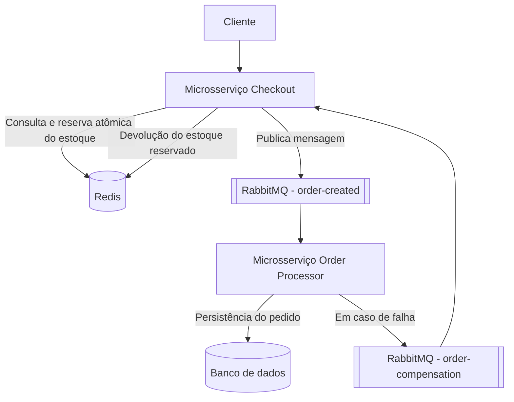

# Flash Sale - Checkout e Reserva de Estoque Relâmpago

Projeto desenvolvido para a disciplina de Back-End da **ADA**, implementando o desafio descrito em [Projeto_final.md](Projeto_final.md): um sistema de checkout para promoções relâmpago (_Flash Sale_), com reserva de estoque no Redis, processamento assíncrono via RabbitMQ e compensação de falhas aplicando uma **SAGA coreografada simplificada** (sem orquestrador central — cada serviço reage aos eventos que recebe).

### Sumário

- [Tecnologias](#tecnologias)
- [Ferramentas utilizadas](#ferramentas-utilizadas)
- [Arquitetura Proposta](#arquitetura-proposta)
- [Execução do projeto](#execução-do-projeto)
  - [01 - Subindo a infraestrutura via Docker Compose](#01---subindo-a-infraestrutura-via-docker-compose)
  - [02 - Build e testes via Maven](#02---build-e-testes-via-maven)
  - [03 - Executando os microsserviços manualmente via CLI](#03---executando-os-microsserviços-manualmente-via-cli)
- [Acessando a aplicação](#acessando-a-aplicação)
- [Acessando o RabbitMQ Management](#acessando-o-rabbitmq-management)
- [Dados da API](#dados-da-api)
  - [Produto inicial e seu estoque](#produto-inicial-e-seu-estoque)
  - [Endpoint para consultar o estoque](#endpoint-para-consultar-o-estoque)
  - [Endpoint para criar um pedido](#endpoint-para-criar-um-pedido)
  - [Endpoint para consultar um pedido](#endpoint-para-consultar-um-pedido)
  - [Simulando falha e compensação](#simulando-falha-e-compensação)
- [Acesso ao PostgreSQL](#acesso-ao-postgresql)
- [Testes automatizados](#testes-automatizados)
- [Estado de entrega](#estado-de-entrega)
- [Autor](#autor)

## Tecnologias

- **Java 21**
- **Spring Boot 3.5.5** (Web, Validation, Data JPA, Data Redis, AMQP, Actuator)
- **RabbitMQ** (comunicação assíncrona entre os serviços)
- **Redis** (reserva atômica de estoque e cache de consulta — Cache-Aside)
- **PostgreSQL** (um banco por microsserviço — outbox pattern nos dois)
- **Flyway** (migrations versionadas de cada banco)
- **Maven** (monorepo multi-módulo)
- **JUnit 5, Mockito, AssertJ** (testes unitários e MVC)

## Ferramentas utilizadas

- **VS Code**
- **Docker Desktop / Docker Compose**
- **Maven 3.8+**
- **JDK 21**

## Arquitetura Proposta



Na arquitetura, temos dois serviços independentes, cada um com seu próprio banco (DDD + banco segregado):

- **checkout-service**: recebe o pedido, valida os dados, reserva o estoque no Redis de forma atômica (script Lua), persiste uma projeção local `PROCESSING` e grava o evento `order-created` numa outbox PostgreSQL na mesma transação. Um publisher agendado envia a outbox ao RabbitMQ com confirmação do broker. Também expõe a consulta de pedidos (Cache-Aside com Redis) e consome as filas `order-status-updated` e `order-compensation` para manter sua projeção local e devolver estoque em caso de falha.
- **order-processor-service**: consome `order-created`, persiste o pedido em seu próprio banco PostgreSQL, confirma ou simula falha (`ORDER_PROCESSOR_SIMULATE_FAILURE`), e publica os eventos de status/compensação também via outbox própria.

Ambos os serviços usam **outbox pattern** (evento gravado na mesma transação local, publicado depois com confirmação do broker) para nunca perder uma mensagem, e retry com backoff + Dead Letter Queue nos consumidores.

## Execução do projeto

Há duas formas de rodar o projeto: subindo a infraestrutura via Docker Compose e os microsserviços manualmente via Maven — **não há Dockerfile para os próprios microsserviços**, apenas para a infraestrutura (Redis, RabbitMQ e os dois PostgreSQL).

Para rodar o projeto, é necessário ter instalado:

- **JDK 21**
- **Maven 3.8+**
- **Docker com Docker Compose** (para Redis, RabbitMQ e PostgreSQL)

### 01 - Subindo a infraestrutura via Docker Compose

Basta executar o comando no diretório raiz do repositório:

```powershell
docker compose up -d
```

O Redis fica em `localhost:6379`, o RabbitMQ em `localhost:5672` (painel em `http://localhost:15672`), o banco do Checkout em `localhost:5433` e o banco do Processor em `localhost:5434`.

Para parar tudo:

```powershell
docker compose down
```

### 02 - Build e testes via Maven

```powershell
mvn test
```

Roda os 35 testes unitários e MVC (rápidos, com mocks). Para rodar também os testes de integração com infraestrutura **real** (Redis e PostgreSQL embarcados em processo, sem precisar de Docker):

```powershell
mvn verify
```

Veja a seção [Testes automatizados](#testes-automatizados) para detalhes do que cada suíte cobre.

### 03 - Executando os microsserviços manualmente via CLI

Com a infraestrutura do passo 01 no ar, use dois terminais separados (a partir da raiz do repositório):

```powershell
mvn -pl checkout-service spring-boot:run
```

```powershell
mvn -pl order-processor-service spring-boot:run
```

Ao iniciar o Checkout, o estoque de `PROD-001` começa em 100 unidades (carga idempotente via `SET NX` — não substitui saldo já existente). Configure `INITIAL_STOCK_PRODUCT_ID` e `INITIAL_STOCK_QUANTITY` para alterar produto e saldo inicial.

## Acessando a aplicação

As aplicações executam nas seguintes portas:

| Serviço                 | Porta   |
| ----------------------- | ------- |
| checkout-service (API)  | `8081`  |
| order-processor-service | `8082`  |
| Redis                   | `6379`  |
| RabbitMQ                | `5672`  |
| RabbitMQ Management     | `15672` |
| PostgreSQL (Checkout)   | `5433`  |
| PostgreSQL (Processor)  | `5434`  |

Os health checks ficam em `/actuator/health` nas portas `8081` e `8082`.

**Interface gráfica de visualização (extra, além do MVP):** com o `checkout-service` no ar, acesse [http://localhost:8081](http://localhost:8081) para criar pedidos, consultar status (com atualização automática enquanto `PROCESSING`) e ver o histórico de pedidos criados na sessão do navegador. É uma página estática (HTML/CSS/JS puro, sem build, sem dependências novas) servida pelo próprio `checkout-service` — a seção 8 do `Projeto_final.md` não exige interface gráfica, esta foi adicionada com intenção de facilitar a visualização do fluxo.

## Acessando o RabbitMQ Management

Para visualizar as filas (`order-created`, `order-status-updated`, `order-compensation` e suas respectivas `.dlq`) e as mensagens publicadas, acesse:

[http://localhost:15672](http://localhost:15672)

Usuário e senha padrão: `guest` / `guest`.

## Dados da API

### Produto inicial e seu estoque

O produto `PROD-001` é carregado automaticamente com **100 unidades** ao iniciar o `checkout-service` (configurável via `INITIAL_STOCK_PRODUCT_ID`/`INITIAL_STOCK_QUANTITY`).

### Endpoint para consultar o estoque

**GET** `http://localhost:8081/v1/stock`

```powershell
curl.exe http://localhost:8081/v1/stock
```

Retorna a quantidade disponível de cada produto configurado (lido diretamente do Redis):

```json
[
  {
    "produto_id": "PROD-001",
    "quantidade_disponivel": 100
  }
]
```

É esse endpoint que alimenta a seção "Estoque atual" da interface gráfica em `http://localhost:8081`.

### Endpoint para criar um pedido

**POST** `http://localhost:8081/v1/orders`

```powershell
curl.exe -X POST http://localhost:8081/v1/orders `
	-H "Content-Type: application/json" `
	-d '{"produto_id":"PROD-001","quantidade":2,"cliente_cpf":"50329291076","cliente_nome":"Fernando Augusto"}'
```

Payload:

```json
{
  "produto_id": "PROD-001",
  "quantidade": 2,
  "cliente_cpf": "50329291076",
  "cliente_nome": "Fernando Augusto"
}
```

Resposta — sucesso (`202 Accepted`):

```json
{
  "pedido_id": "b819cc65-f6f0-478c-8bb7-69ee1c4f6402",
  "status": "PROCESSING",
  "data_hora_requisicao": "2026-09-07T20:03:57"
}
```

Resposta — estoque insuficiente (`409 Conflict`):

```json
{
  "mensagem": "Estoque insuficiente para o produto PROD-001"
}
```

Outras respostas possíveis: `400 Bad Request` (dados inválidos ou corpo malformado) e `503 Service Unavailable` (falha ao registrar o pedido, com devolução automática do estoque reservado).

### Endpoint para consultar um pedido

**GET** `http://localhost:8081/v1/orders/{pedido_id}`

```powershell
curl.exe http://localhost:8081/v1/orders/b819cc65-f6f0-478c-8bb7-69ee1c4f6402
```

Resposta — pedido encontrado (`200 OK`):

```json
{
  "pedido_id": "b819cc65-f6f0-478c-8bb7-69ee1c4f6402",
  "produto_id": "PROD-001",
  "quantidade": 2,
  "cliente_cpf": "50329291076",
  "cliente_nome": "Fernando Augusto",
  "status": "CONFIRMED",
  "data_hora_atualizacao": "2026-09-07T20:04:10"
}
```

Resposta — pedido não encontrado (`404 Not Found`, após 3 tentativas de busca):

```json
{
  "mensagem": "Pedido não encontrado"
}
```

A consulta segue o padrão **Cache-Aside**: Redis primeiro (TTL de 5 minutos), banco depois em caso de _miss_.

### Simulando falha e compensação

O `order-processor-service` confirma pedidos por padrão. Para demonstrar o fluxo de falha e compensação, inicie-o com a variável de ambiente `ORDER_PROCESSOR_SIMULATE_FAILURE=true`; todo pedido recebido nessa execução será cancelado (`CANCELLED`), disparando a compensação que devolve o estoque reservado no Redis.

```powershell
$env:ORDER_PROCESSOR_SIMULATE_FAILURE = "true"
mvn -pl order-processor-service spring-boot:run
```

## Acesso ao PostgreSQL

Para conectar-se ao banco do Checkout via linha de comando, direto do container:

```powershell
docker exec -it ada-backend-java-iii-checkout-db-1 psql -U checkout -d checkout
```

Para o banco do Processor:

```powershell
docker exec -it ada-backend-java-iii-processor-db-1 psql -U orders -d orders
```

Consultas úteis dentro do `psql`:

```sql
-- Projeção de pedidos no Checkout
SELECT * FROM order_projection;

-- Outbox do Checkout (eventos pendentes de publicação)
SELECT * FROM checkout_outbox_event WHERE published_at IS NULL;

-- Pedidos persistidos no Processor
SELECT * FROM orders;

-- Outbox do Processor
SELECT * FROM outbox_event WHERE published_at IS NULL;
```

## Testes automatizados

- **`mvn test`** — 35 testes unitários e de MVC (com Mockito), cobrindo validação, transições de estado, reserva/devolução de estoque, criação e consulta de pedidos (200/400/404/409/503), outbox, compensação e idempotência.
- **`mvn verify`** — além dos testes acima, executa testes de integração contra infraestrutura **real embarcada em processo** (sem precisar de Docker):
  - `RedisStockServiceConcurrencyIT`: prova, com Redis real, que reservas concorrentes nunca deixam o estoque negativo, e que a devolução de estoque é idempotente.
  - `RedisOrderCacheIT`: prova, com Redis real, o TTL de 5 minutos e o comportamento de eviction do Cache-Aside.
  - `CheckoutPersistenceIT` / `OrderProcessorPersistenceIT`: validam as migrations Flyway e o mapeamento JPA contra um PostgreSQL real embarcado; em máquinas com política de grupo restritiva que bloqueie a execução do binário embarcado, esses testes abortam de forma controlada em vez de falhar o build.

## Estado de entrega

O build e os testes unitários/MVC são executados com `mvn test`; os testes de integração com Redis e PostgreSQL reais (embarcados, sem Docker) são executados com `mvn verify`. RabbitMQ não tem um substituto embarcado equivalente, então a validação ponta a ponta com filas, bancos reais e os health checks depende de um ambiente com Docker disponível. O checklist de implementação, decisões e bloqueios estão em [TODO.md](TODO.md); um roteiro de explicação técnica para apresentação está em [APRESENTACAO.md](APRESENTACAO.md).

## Autor

### Thiago Banfi Credico
